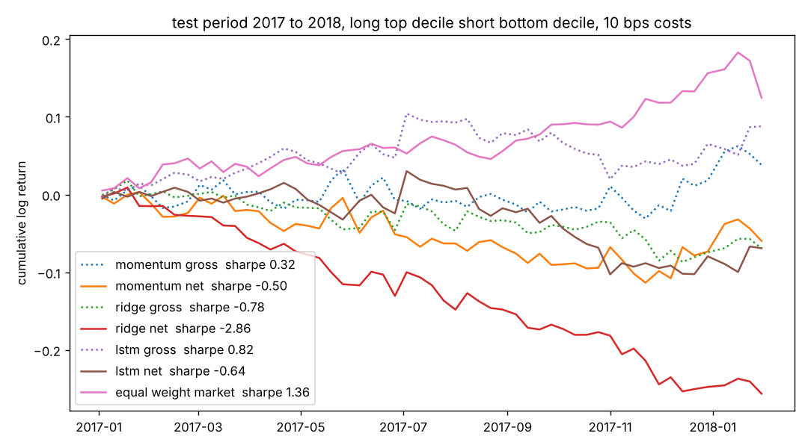

# Cross sectional stock ranking with an LSTM

Can a small recurrent network rank S&P 500 stocks by their return over the next week better than momentum or a linear model? This project trains one on five years of daily prices, measures it the way a quant desk would (daily rank information coefficient and a long short decile backtest with transaction costs) and reports what it finds, including the part where costs eat the edge.

## Data

Daily open, high, low, close and volume for S&P 500 members from February 2013 to February 2018, from the public `all_stocks_5yr.csv` file mirrored in the [plotly datasets](https://github.com/plotly/datasets) repo. `data.py` downloads it, keeps the 474 tickers with a full history, and builds four features per stock per day:

* one day log return
* 20 day rolling volatility
* one day change in log volume
* 20 day momentum

Each feature is standardised across the cross section every day, so the model sees "this stock's volatility relative to the rest of the market today" rather than raw levels. The input to the model is the last 20 days of these four features, and the target is the log return over the next 5 trading days, also standardised across the cross section each day so the network learns to rank rather than to predict the market.

That gives 575k training windows. The split is strictly by time: train up to June 2016, validation to December 2016, test is calendar 2017 to February 2018.

## Models

* **momentum**: just use the 20 day momentum feature as the score. No training.
* **ridge**: ridge regression on the flattened 20 x 4 window.
* **LSTM**: single layer LSTM with 32 hidden units, dropout, linear head, trained with MSE for 8 epochs and early stopped on validation rank IC.

## Evaluation

Rank IC is the Spearman correlation between the model's scores and the realised forward returns, computed each day and averaged. The t statistic tells you whether the average is distinguishable from zero.

The backtest rebalances every 5 trading days, goes long the top decile and short the bottom decile equal weighted, and charges 10 basis points on every dollar that turns over. Gross curves are dotted, net curves are solid.

## Results on the test period

| model | rank IC | t stat | gross Sharpe | net Sharpe |
| --- | --- | --- | --- | --- |
| momentum | 0.004 | 0.4 | 0.32 | negative |
| ridge | negative | | negative | negative |
| LSTM | 0.015 | 1.9 | 0.82 | negative |
| equal weight long only market | | | 1.36 | |



A few things worth saying out loud.

The LSTM does have a small positive rank IC that the linear model does not, and its gross long short Sharpe of 0.8 is respectable for a signal built from nothing but price and volume. An IC of 0.015 is also in the range practitioners quote for single price based signals, so the number is believable rather than suspicious.

But the strategy flips most of its book every week. Turnover near 100 percent per leg per rebalance means roughly 40 basis points of cost every five days, which is about 20 percent a year, and that wipes out an 8 percent gross return. The net curve is below zero for every model. Slower signals, holding positions longer, or trading only when the rank changes a lot would all reduce this, and that is the real engineering problem in short horizon equity prediction rather than the model architecture.

2017 was also a strong, low volatility year where simply owning everything had a Sharpe of 1.4, which no long short signal here comes close to.

## Running it

```
pip install -r requirements.txt
python train.py
```

The download is about 30 MB and training takes about a minute on a laptop CPU. Outputs go to `results/`: `metrics.json`, `backtest.png` and the LSTM weights.
